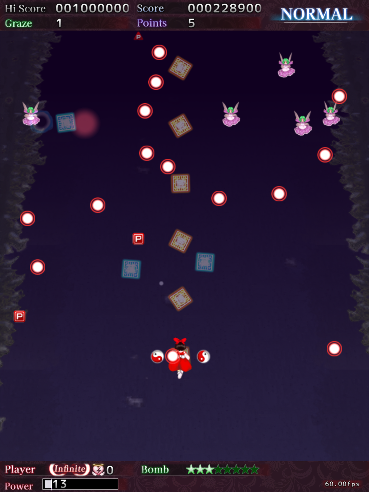

# th06nc-tate
THRotator-style tate mod for Touhou Koumakyou: New Classic ~ the Embodiment of Scarlet Devil



## Installation
1. Download the latest release zip.
2. Copy `dxgi.dll`, `th06nc-tate.ini` and `th06nc-tate-bg.bmp` into the game folder, next to `th06nc.exe` (Steam: right-click the game > Manage > Browse local files).

### Linux / Proton
Also set the Steam launch options to:
```
WINEDLLOVERRIDES="dxgi=n,b" %command%
```

## Hotkeys (in game)
| Keys | Action |
|---|---|
| Alt+Left | Rotate clockwise |
| Alt+Right | Rotate counterclockwise |
| Alt+Up | Force HUD layout |
| Alt+Down | Force whole screen |
| Alt+0 | Settings menu (Save writes `th06nc-tate.ini`) |

## How it works
- Gameplay is detected from the gold playfield frame: HUD layout in game, whole screen in menus.
- Portrait or 4:3 desktops: set the game to fullscreen, and keep rotation at 0 if the desktop itself is rotated.
- CRTs / stretched screens: set **Screen shape** in the Alt+0 menu (Display) to the screen's real shape.
- If something breaks, check `th06nc-tate-log.txt` in the game folder.

## Notes
- As of now, from my testing, Special K does not work with this mod. I may try to fix it in the future.
- Borderless windowed and fullscreen both work on a horizontal 16:9 desktop. On a vertical desktop, use fullscreen; borderless windowed is glitched there.

## Building
Install mingw-w64, then run `./build.sh` (makes `dxgi.dll`):
- Arch / Artix: `sudo pacman -S mingw-w64-gcc`
- Debian / Ubuntu: `sudo apt install g++-mingw-w64-x86-64`
- Fedora: `sudo dnf install mingw64-gcc-c++`

## Credits
- Inspired by [THRotator](https://github.com/massanoori/THRotator)
- Settings menu uses [Dear ImGui](https://github.com/ocornut/imgui) (MIT license, see `imgui/LICENSE.txt`)
